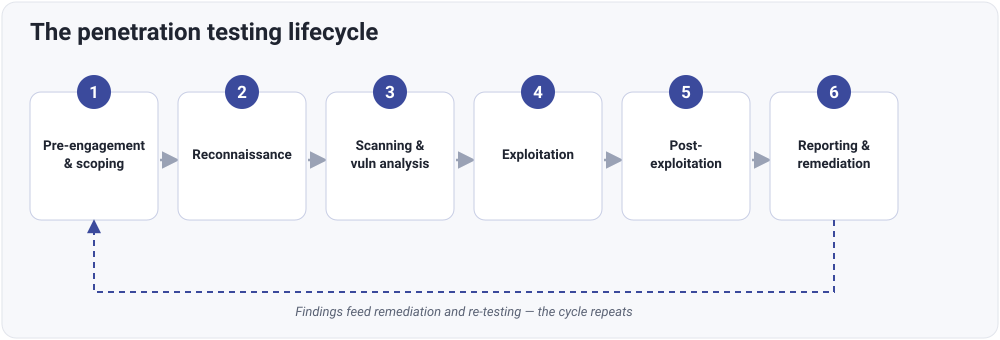

# Penetration testing methodology

## The concept

Where the [engagement lifecycle](engagement-lifecycle.md) describes the
professional shape of a job — from first conversation to remediation — the
**methodology** is the structured sequence of technical phases the test itself
moves through. A consistent methodology is what makes testing repeatable,
thorough, and defensible: you cover the same ground every time, in a sensible
order, and nothing important gets skipped.

The phases run in order, but the process is a **cycle**, not a one-way line:
findings feed remediation, remediation is re-tested, and the next engagement
starts from a better-understood baseline.

## The six core phases

### 1. Pre-engagement & scoping

Everything that must be agreed before any testing begins.

- Define the **targets and objectives** — what's being tested, and what the
  client actually wants to learn.
- Agree the **scope** and **rules of engagement (RoE)**: what's in and out,
  what techniques are permitted, timing, and escalation contacts.
- Settle **timelines and resources**.
- Secure **written legal authorisation** — the basis that makes the whole test
  lawful.
- Agree the **test type**:
    - **Black box** — no prior knowledge; simulates an external attacker.
    - **White box** — full knowledge (architecture, source, credentials); a
      thorough internal review.
    - **Grey box** — partial knowledge (e.g. a standard user login); often the
      best coverage per day of effort.

This phase is covered in depth under [scoping & rules of
engagement](scoping.md) and [legal & compliance](legal-compliance.md).

!!! warning "Nothing starts without this"
    Testing before scope and written authorisation are agreed isn't a shortcut
    — it's how an engagement becomes a legal problem. Phase 1 is the gate.

### 2. Reconnaissance (information gathering)

Building a picture of the target before engaging deeply.

- **Passive reconnaissance** — gathering public intelligence (OSINT, DNS
  records, public documents) **without touching the target**, so there's
  nothing to detect.
- **Active reconnaissance** — direct but low-key interaction (host discovery,
  banner grabbing) to identify live systems and services.

The aim is to map the attack surface quietly and accurately. This is the whole
subject of the [information gathering](../information-gathering/index.md)
section.

### 3. Scanning & vulnerability analysis

Turning the recon picture into a list of concrete, candidate weaknesses.

- Use **automated tools** (port scanners like Nmap, vulnerability scanners like
  Nessus or OpenVAS) to map open ports, running services, misconfigurations,
  and known vulnerabilities (CVEs).
- Critically, apply **manual verification** — scanners produce false positives
  and miss logic flaws, so each finding that matters is validated by hand.

The discipline of *validating* rather than trusting tool output is covered in
[vulnerability assessment](../vulnerability-assessment/index.md). This is also
where the [assessment-vs-pentest](../vulnerability-assessment/assessment-vs-pentest.md)
distinction becomes real: scanning *identifies*, the later phases *prove*.

### 4. Exploitation

Safely demonstrating that an identified weakness has real consequences.

- Attempt, **in a controlled and authorised way**, to confirm that a weakness
  is genuinely exploitable (e.g. injection flaws, weak credentials,
  misconfigurations).
- The goal is to **evidence impact and validate risk** — not to cause damage or
  collect trophies.
- Everything stays within the agreed RoE, with [risk](risk-management.md)
  actively managed throughout.

The conceptual treatment — what makes systems exploitable, and how to defend —
is in [exploitation concepts](../exploitation-concepts/index.md).

### 5. Post-exploitation & lateral movement

Determining how deep a compromise could actually go.

- Assess the **depth** of a foothold: escalating privileges, testing whether
  persistence is possible, and seeing whether an attacker could **move
  laterally** across the internal network or into cloud environments.
- This is what distinguishes "a box was vulnerable" from "here's what an
  attacker could do to the business."

How these mechanics work, and the architecture and hygiene that contain them,
are covered in [post-exploitation & lateral
movement](../exploitation-concepts/post-exploitation.md).

### 6. Reporting & remediation

Turning the whole engagement into something the client can act on.

- Deliver a **two-part report**: an **executive summary** framing business risk
  for management, and a **technical breakdown** with step-by-step reproduction
  and severity ratings for the people who'll fix things.
- Provide clear, prioritised, **actionable remediation**.
- Support the fix, and **re-test** afterwards to confirm it worked — which is
  where the cycle begins again.

Good reporting is the deliverable the client actually paid for; it's covered in
[reporting & documentation](reporting.md).

## Recognised methodologies

You don't have to invent a methodology — several well-regarded, public
frameworks formalise this process, and it's worth knowing their names:

| Framework | Focus |
|---|---|
| **PTES** (Penetration Testing Execution Standard) | End-to-end methodology closely matching the phases above |
| **OWASP WSTG** (Web Security Testing Guide) | The authoritative methodology for web application testing |
| **NIST SP 800-115** | US government technical guide to security testing |
| **OSSTMM** | Open Source Security Testing Methodology Manual |
| **MITRE ATT&CK** | A catalogue of real-world attacker tactics and techniques, useful for structuring the exploitation and post-exploitation phases |

Aligning your work to a recognised framework makes it more consistent, easier to
explain to clients, and easier to defend.

!!! note "Check your understanding"
    - Why is the methodology best thought of as a cycle rather than a one-way
      line?
    - At which phase does the difference between a vulnerability assessment and
      a penetration test become concrete?
    - Why does the final report have two distinct parts, and who is each for?
    - What's the single thing that must exist before phase 2 can begin?
